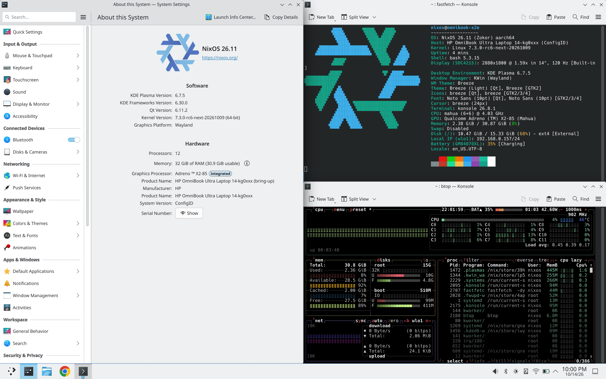

# HP OmniBook Ultra 14-kg0xxx NixOS

**NOT STABLE**, **WIP**.

> **Disclaimer:** This project is provided as-is, with no warranties of any kind. Installing custom kernels, device trees, or early-stage firmware on your machine carries inherent risks. I am not responsible for any bricked devices, lost data, hardware damage, or system instability caused by using these configurations or instructions. Proceed at your own risk.

A bootable NixOS (KDE Plasma) image for the HP OmniBook Ultra 14 with
Snapdragon X2 Elite. It runs entirely from a USB stick: the internal SSD and
Windows are never touched, and unplugging the stick gets you back to Windows.
The kernel is `linux-next` plus the patches listed below, because support for
this laptop is not in a released kernel yet.



- [Supported devices](#supported-devices)
- [Status](#status)
- [Quick start](#quick-start)
  - [1. Requirements](#1-requirements)
  - [2. Install Nix in WSL](#2-install-nix-in-wsl)
  - [3. Get the repository](#3-get-the-repository)
  - [4. Extract the firmware](#4-extract-the-firmware)
  - [5. Build the image](#5-build-the-image)
  - [6. Write the USB stick](#6-write-the-usb-stick)
  - [7. Boot it](#7-boot-it)
- [Using the system](#using-the-system)
- [Patches in use](#patches-in-use)
- [Firmware](#firmware)
  - [Extracting the HP firmware](#extracting-the-hp-firmware)
  - [Where everything comes from](#where-everything-comes-from)
- [AI disclosure](#ai-disclosure)
- [References](#references)


## Supported devices

- HP OmniBook Ultra 14-kg0xxx running 12 cores Snapdragon X2 Elite (Mahua)
- HP OmniBook Ultra 14-kg0xxx running 18 cores Snapdragon X2 Elite (Glymur) - Untested (board v2 names the sound card `GLYMUR-HP-OmniBook-Ultra-14-kg0xxx`, which has no topology in linux-firmware yet: expect no audio)

## Status

| Works | Notes |
| --- | --- |
| Boot from USB stick | Both USB-C plug orientations (`pmic_glink` stack in the initrd) |
| Internal display (eDP) | `msm`, 60/120 Hz, brightness |
| GPU acceleration | freedreno "Adreno X2-85 (Mahua)" via a patched Mesa device table |
| KDE Plasma 6 (Wayland) | Default boot entry "NixOS KDE (msm)" |
| Keyboard, keyboard backlight, touchpad, touchscreen | |
| Speakers, internal microphones | UCM via `GLYMUR-CRD.conf`; volume capped by the kernel (see below), thinner sound than Windows (no HP DSP processing) |
| Wi-Fi | Board file borrowed from another HP laptop (linux-firmware `103c:8d99`) |
| Bluetooth | |
| Cameras (RGB + IR) | USB UVC |
| Battery level, lid switch | |
| USB-C data | Both orientations |
| External monitor (USB-C DP) | All ports, both orientations, resolution/refresh/brightness OK |
| CPU frequency and idle | `scmi-cpufreq`: 0.36-3.42 GHz (cores 0-5), 0.36-4.03 GHz (cores 6-11); PSCI idle states used. 7-Zip multi-thread: 92.5 GIPS vs 89.2 on Windows; all-core load sustained at 86-92 °C without throttling |
| Fan | |

| Partial / not working / untested | Notes |
| --- | --- |
| Suspend (s2idle) | Suspends and resumes, but the SoC never reaches its low-power state (DDR/CX sleep counters stay at 0): power LED stays on, battery drains as if idle |
| CPU boost | Enabled, but a single thread stays at 4.03 GHz; Windows reaches ~4.6 GHz (see below) |
| Speaker volume | The kernel caps the amplifiers at 0 dB (`PA Volume` 6 of 12) and the digital gain at -3 dB until speaker protection exists |
| Colour banding | Until the refresh rate is changed once after login |
| HDR, VRR | The panel supports both (HDR10 static metadata, 10 bpc, 30-120 Hz adaptive sync); the `msm` eDP driver does not |
| Resolution / refresh choices | Only the panel's native mode at 60 or 120 Hz |
| Power profiles | No `platform_profile` driver on this SoC: placeholders only |
| Wi-Fi calibration | Not this laptop's board data: range/TX power may differ from Windows |
| Wi-Fi in the tty entries | No NetworkManager there; use a KDE entry |
| 3.5 mm headphones jack | Untested |
| External monitor audio | Not supported: the Glymur topology and UCM have no DisplayPort audio yet |
| Woofers with EasyEffects | Fixed with a stereo "Speakers" sink that upmixes to all four (FL/FR = tweeters, RL/RR = woofers) |
| NPU | Untested. System side in the image: CDSP (Hexagon v81) + `fastrpc` driver, `libcdsprpc` (FastRPC 1.0.8), `/dev/fastrpc-cdsp*` and `/dev/dma_heap/system` for the `fastrpc` group, CDSP shells in `/usr/lib/dsp`. The QNN libraries and onnxruntime are not included |

### CPU: Linux vs Windows (7-Zip 26.02 benchmark, 12 threads, on battery)

Both runs were on battery; Snapdragon laptops are expected to have the same
CPU power limits on battery as plugged in.

| | Linux (`7zz b`) | Windows 11 (7-Zip GUI) |
| --- | --- | --- |
| Total rating | 92 473 MIPS | 89 179 MIPS |
| Compression | 97 083 MIPS | 94 430 MIPS |
| Decompression | 87 863 MIPS | 83 929 MIPS |
| CPU usage | 1050% | 1078% |
| 1-thread clock | 4026 MHz | 4584-4675 MHz |
| 12-thread clock | ~3100-3384 MHz | ~3316-3357 MHz |

Multi-thread performance is on par (Linux about 4% ahead). Single-thread
runs about 13% slower on Linux because the boost clocks are not granted.

## Quick start

Everything below is done on the OmniBook itself, in Windows, using WSL.
Building there means a native ARM64 build (no cross-compilation), and the
firmware the image needs is read from the same Windows install.

### 1. Requirements

- The laptop, with Windows and [WSL 2](https://learn.microsoft.com/windows/wsl/install)
  (`wsl --install` in an administrator terminal installs Ubuntu).
- Plenty of free disk space: the kernel and some packages are built from
  source, and the Nix store needs tens of GB.
- A USB stick of 32 GB or more (everything on it is erased): the image alone
  is 16 GB. USB-C or USB 3 is much faster to run from.
- Your **BitLocker recovery key** (<https://aka.ms/myrecoverykey>): turning
  Secure Boot off makes Windows ask for it on its next start.

### 2. Install Nix in WSL

In the WSL (Ubuntu) terminal, install Nix with the official installer
(<https://nixos.org/download/#nix-install-linux>), then enable flakes:

```bash
mkdir -p ~/.config/nix
echo "experimental-features = nix-command flakes" >> ~/.config/nix/nix.conf
```

Open a new terminal and check that `nix --version` works.

### 3. Get the repository

```bash
git clone https://github.com/Klbgr/HP-OmniBook-Ultra-14-kg0xxx-NixOS
cd HP-OmniBook-Ultra-14-kg0xxx-NixOS
```

The image uses a French (AZERTY) keyboard layout. To change it, edit
`console.keyMap` and `services.xserver.xkb.layout` in `configuration.nix`
(for example `"us"`).

### 4. Extract the firmware

The audio and USB-C DSP firmware is signed by HP and cannot be shared, so it
is copied from your own Windows install:

```bash
./extract-firmware.sh
```

It reads `C:\Windows` through `/mnt/c` and fills `firmware/qcom/...`. See
[Firmware](#firmware) for details and for doing it by hand.

### 5. Build the image

```bash
nix build -L "path:$PWD"
```

The `path:` part matters: the extracted firmware is git-ignored, and a plain
`nix build` (or building straight from GitHub) only sees files tracked by
git, so it stops with "HP firmware missing". Keep the laptop plugged in and
awake until the build finishes.

The result is `result/omnibook-x2e.raw`.

### 6. Write the USB stick

Copy the image to Windows, for example:

```bash
cp -L result/omnibook-x2e.raw /mnt/c/Users/<your Windows user>/Downloads/
```

Then write it with [Rufus](https://rufus.ie) (pick the `.raw` file; use DD
mode if asked) or [balenaEtcher](https://etcher.balena.io). From Linux,
`sudo dd if=result/omnibook-x2e.raw of=/dev/sdX bs=4M conv=fsync status=progress`
works too. Wait until the write has fully finished before unplugging.

### 7. Boot it

1. Restart and press **F10** for the BIOS setup; disable **Secure Boot**.
2. Plug the stick in, restart and press **F9** for the boot menu; pick the
   USB stick.
3. In the menu, the default entry **NixOS KDE (msm)** starts the desktop.
   Log in as `nixos` / `nixos`.

To go back to Windows, unplug the stick and restart (re-enable Secure Boot
in F10 if you want; have the BitLocker key at hand).

## Using the system

Boot entries:

| Entry | What it is |
| --- | --- |
| **NixOS KDE (msm)** (default) | Desktop with GPU acceleration |
| NixOS KDE (msm, cluster CL4 test) | Same, with an extra CPU cluster idle state (single-core boost experiment) |
| NixOS KDE (software rendering) | Desktop without the display driver (CPU rendering), if the default shows a black screen |
| NixOS tty (msm) | Text console with the display driver |
| NixOS tty | Text console on the firmware framebuffer, the safest fallback |

- Accounts: `nixos` / `nixos` (desktop, `sudo`); `root` / `nixos`. The text
  console logs in as root automatically.
- Wi-Fi and Bluetooth are set up in the KDE entries (NetworkManager), not in
  the text-console ones.
- Changes made while running are kept on the stick, but the system itself
  is defined by this repository: change `configuration.nix`, rebuild and
  rewrite the stick.

Reporting a problem: run `sudo omnibook-diag`. It writes
`omnibook-diag.txt` to the stick's boot partition, which Windows can open
(it shows up as a small drive when the stick is plugged in). If the system
crashed or froze, boot again first: the report includes the previous boot's
kernel log.

## Patches in use

Applied by `buildLinux` on top of `linux-next` tag `next-20261102`
(`7.4.0-rc1`), in this order (`kernelPatches` in `configuration.nix`):

| # | File | What | Source |
| --- | --- | --- | --- |
| 1 | `patches/mahua-gpu-v1-dt.patch` | Patches 2/5 (Glymur GMU compatible) and 5/5 (`mahua.dtsi` GPU/GMU nodes) of the Mahua GPU series; the driver part is in `linux-next` | <https://lore.kernel.org/all/20260925-mahua-gpu-v1-0-0fa0bfd8d315@oss.qualcomm.com/> |
| 2 | `patches/glymur-mahua-hp-omnibook-ultra-kg0xxx.patch` | HP OmniBook Ultra 14-kg0xxx board v2 (binding, Glymur DTS, SCM allowlist) plus the Mahua DTS derived from it (`mahua.dtsi`, no cluster2 PMIC, no `pcie3_phy`, sound model kept at `GLYMUR-CRD`) | <https://lore.kernel.org/linux-arm-msm/20261101-hp-omnibook-v2-v2-0-1b99767deda0@oss.qualcomm.com/> (Mahua DTS: local) |
| 3 | `patches/glymur-mahua-hp-omnibook-ultra-kg0xxx_2.patch` | Local fixes: `pcie3b_phy` (NVMe), REFGEN supplies, Makefile, `qcom,mahua` binding, SCMI `arm,no-completion-irq`, USB `role-switch-default-mode = "host"`, `-bringup` DTB (firmware eUSB2 repeaters) | Local. SCMI item follows <https://github.com/FixItFoundry/zenbook-a16-linux/blob/HEAD/patches/0001-arm64-dts-qcom-glymur-enable-SCMI-polling-mode.patch> |
| 4 | `patches/glymur-dp-phy-pll-v6.patch` | QMP combo PHY: Glymur DP PLL programming (USB-C DisplayPort), 11 patches | patchwork series 1195323 (2026-10-28) |
| 5 | `patches/dispcc-glymur-no-init-park.patch` | Don't park `disp_cc_mdss_mdp_clk_src` at probe (keeps the firmware framebuffer alive) | Local, same change as upstream `dispcc-x1e80100` |
| 6 | `patches/phy-qcom-edp-v8.patch` | eDP panel PHY v8 power-on sequence (2 patches, Bjorn Andersson) | <https://lore.kernel.org/all/20260622-glymur-edp-phy-v1-0-814b45089ac9@oss.qualcomm.com/> |
| 7 | `patches/qmp-combo-typec-callbacks-v3.patch` | qmp-combo: hold a runtime PM reference in, and check `qmp_combo_com_init()` from, the Type-C switch/mux callbacks (2 patches) | <https://lore.kernel.org/all/20260916133814.3977-1-okerixx@gmail.com/> |
| 8 | `patches/pmic-glink-altmode-ack-undescribed-ports.patch` | pmic_glink_altmode: acknowledge notifications on ports without a connector node (found on the Mahua OmniBook 5) | <https://lore.kernel.org/all/20260930111657.1147-1-theflyingrahul@gmail.com/> |
| 9 | `patches/qmp-pcie-refgen-v3.patch` | qmp-pcie: `vdda-refgen0p9`/`1p2` supplies for Glymur PCIe PHYs (3 patches) | <https://lore.kernel.org/linux-arm-msm/20261013-phy_refgen_1012-v3-0-f28305289499@oss.qualcomm.com/> |
| 10 | `patches/gcc-glymur-usb-ret-on.patch` | gcc-glymur: USB GDSCs retain state (xHCI dies after s2idle resume without it) | <https://lore.kernel.org/all/20261016-glymur-usb-ret-on-v1-1-1790a523fd9c@oss.qualcomm.com/> |
| 11 | `patches/glymur-usb-resume-hs-terminations.patch` | glymur.dtsi: `snps,resume-hs-terminations` on the USB controllers (USB2 resume with the M31 PHY) | patchwork series 1187137 (2026-10-16) |
| 12 | `patches/icc-bwmon-suspend.patch` | icc-bwmon: drop the DDR vote across system suspend | patchwork series 1188352 (2026-10-18) |
| 13 | `patches/dwc3-qcom-defer-vbus-override-v2.patch` | dwc3-qcom: no QSCRATCH access with clocks off when a cable changes during s2idle (SoC reset) | patchwork series 1191670 (2026-10-23) |
| 14 | `patches/msm-dp-runtime-pm-per-plug-v3.patch` | drm/msm/dp: one runtime PM reference per plugged state (leaks on USB-C HPD) | patchwork series 1192548 (2026-10-24) |
| 15 | `patches/a8xx-gmem-base-v2.patch` | drm/msm: correct `GMEM_BASE` on a8xx | patchwork series 1196683 (2026-10-29) |
| 16 | `patches/glymur-fastrpc-cdsp-cb-reg-v5.patch` | glymur.dtsi: CDSP fastrpc context banks 12-14 had wrong `reg` (SMMU faults) (2 patches) | patchwork series 1187001 (2026-10-16) |
| 17 | `patches/mahua-bringup-cluster-cl4.patch` | `mahua-hp-omnibook-ultra-kg0xxx-bringup-cl4.dtb`: the bring-up DTB plus the "CL4" cluster idle state from the ACPI tables (missing in `glymur.dtsi`), for the "NixOS KDE (msm, cluster CL4 test)" entry | Local |

## Firmware

### Extracting the HP firmware

Four files come from the Windows driver store and are not in this
repository (HP/Qualcomm proprietary, git-ignored). They belong to the laptop
model (board `8F03`), not to one machine, but they cannot be redistributed.
The script also copies the two CDSP process shells (`fastrpc_shell_3`,
`fastrpc_shell_unsigned_3`, from the same CDSP package, into `dsp/cdsp/`),
used for NPU offload; the image builds without them.

`./extract-firmware.sh [WINDOWS_DIR]` copies them; `WINDOWS_DIR` defaults to
`/mnt/c/Windows` (WSL). From a Linux system, mount the Windows partition
read-only and pass its `Windows` directory. It picks the ADSP package whose
INF lists `SUBSYS_8F03103C` (override with `SUBSYS=...`) and the newest CDSP
package.

By hand: in `C:\Windows\System32\DriverStore\FileRepository`, copy

| From the folder | Files | To |
| --- | --- | --- |
| `qcsubsys_ext_adsp8480.inf_arm64_*` (the one whose `.inf` mentions `SUBSYS_8F03103C`) | `qcadsp8480.mbn`, `adsp_dtbs.elf` | `firmware/qcom/glymur/hp/omnibook-ultra-14-kg0xxx/` |
| `qcnspmcdm8480.inf_arm64_*` (newest version) | `qccdsp8480.mbn`, `cdsp_dtbs.elf` | same |
| same folder, `CDSP/` | `fastrpc_shell_3`, `fastrpc_shell_unsigned_3` | `dsp/cdsp/` |

The tested files have these SHA-256 sums (newer Windows driver updates can
differ and should still work):

```text
0b68b188aac54f7beecb3234c19e794092864a4690aafea20bf379643305bf93  qcadsp8480.mbn
c1a69fe37eaff8759b22738f4d4b8e046e7b07fbccdfdc76554f0fa6b412b981  adsp_dtbs.elf
c6aa4cdd64fdc132e18dedff633e0cca4d9fd816043f72d3e513ec5173b0300b  qccdsp8480.mbn
d09353b85ed4961800d1224d9e65c7b6001225ceb908535ad0f89dcd1df0ffc7  cdsp_dtbs.elf
b466c730455586ab4ab852c61aa145309a4706b0418fae7c66cb9436e92986b4  fastrpc_shell_3
bd9cd1c7a77512cd42b442029d5a2fefdcd9b0a7203a468faaab3bd168690aed  fastrpc_shell_unsigned_3
```

### Where everything comes from

Everything not listed here comes from nixpkgs' `linux-firmware`
(`hardware.enableRedistributableFirmware`): GPU (`qcom/gen80100_*`), Wi-Fi
(`ath12k/WCN7850/hw2.0/amss.bin`, `m3.bin`, `board-2.bin` which also holds
the regdb), Bluetooth (`qca/hmtbtfw20.tlv`, `qca/hmtnv20.b112`), audio
topology. Files in `firmware/` (laid out like `/lib/firmware`) are added
to `hardware.firmware`; the four DSP files are also copied into the initrd
under `/fw` (`firmware_class.path=/fw`) because `qcom_q6v5_pas` boots the
ADSP there for USB-C orientation.

| `firmware/...` | Source | Used for |
| --- | --- | --- |
| `qcom/glymur/hp/omnibook-ultra-14-kg0xxx/qcadsp8480.mbn`, `adsp_dtbs.elf` | Windows driver store, `qcsubsys_ext_adsp8480.inf_arm64_f8056c8c0730b734` (HP, `SUBSYS_8F03103C`) | ADSP: audio, battery/USB-C (pmic_glink) |
| `qcom/glymur/hp/omnibook-ultra-14-kg0xxx/qccdsp8480.mbn`, `cdsp_dtbs.elf` | Windows driver store, `qcnspmcdm8480.inf_arm64_cde10e01d3a2d2e1` (30.0.228) | CDSP |
| `ath12k/WCN7850/hw2.0/board.bin` | linux-firmware `board-2.bin` entry `subsystem-vendor=103c,subsystem-device=8d99` (another HP laptop, module `bncm865a`), extracted | Wi-Fi board data: no `103c:8e64` entry exists upstream, and HP's own files crash the upstream Wi-Fi firmware |

Board files tried for Wi-Fi: linux-firmware's HP `103c:8d99` (in use) and
`103c:8d68` entries both work. HP's Windows files
(`qcwlanhmt8480.inf_arm64_*`, `bdwlan_wcn785x_2p0_ncm825_QC_revB.elf` and
siblings) time out (`-110`) as ELF and crash the firmware (`EE_RDDM`) as raw
images.

## AI disclosure

Most of this repository was written by an AI coding agent (GitHub Copilot
agent mode in VS Code, Claude Opus models), working from my instructions and
from test reports I made on the laptop.

What the AI did:

- Wrote nearly all of the code and text: `configuration.nix`, `image.nix`,
  `flake.nix`, `omnibook-diag.sh`, `extract-firmware.sh`, the local device
  tree patches (the Mahua DTS derived from Qualcomm's Glymur one, the `_2`
  fixes) and this README.
- Checked the patches I picked (useful? already merged?), searched the
  mailing lists (lore, patchwork) for more, and rebased everything onto
  `linux-next`.
- Read the ACPI tables (`dsdt.dsl`), Windows driver files and the kernel
  logs from my test reports to work out the hardware and the causes of
  failures.

What I did:

- Set the goals and priorities, and pointed the AI at specific threads and
  problems.
- Hand-picked a number of the patches from the mailing lists (the board
  series, Mahua GPU, eDP/DP PHY, USB-C, suspend and others) and had the AI
  evaluate and apply them.
- Built every image, flashed it, booted it on the laptop and reported what
  worked and what did not, with the `omnibook-diag` reports.
- Provided the firmware from the laptop's Windows install.
- Decided what goes into the repository.

The AI could not run anything on the laptop: every result in
[Status](#status) comes from my tests on real hardware. Patches marked
"untested" there have only been checked to apply and, for device trees, to
compile.

Not everything in this repository has been tested thoroughly. Even the
features marked as working were only tried briefly, booted from a USB
stick, and the AI-written code has not all been reviewed line by
line. Expect rough edges, and check anything you rely on.

## References

- Board DTS series (Glymur variant, by Qualcomm), v2:
  <https://lore.kernel.org/linux-arm-msm/20261101-hp-omnibook-v2-v2-0-1b99767deda0@oss.qualcomm.com/>
- Mahua GPU/GMU:
  <https://lore.kernel.org/linux-arm-msm/20260925-mahua-gpu-v1-0-0fa0bfd8d315@oss.qualcomm.com/>
- Reference Mahua *board* DTS from Qualcomm (ThinkPad T14s Gen 7), used here as
  the model for what a Mahua board file has to look like:
  <https://lore.kernel.org/all/20260928145122.1337186-1-srinivas.kandagatla@oss.qualcomm.com/>
- Community Mahua bring-up on a sibling HP machine:
  <https://github.com/theflyingrahul/linux-hp-omnibook-5-glymur>