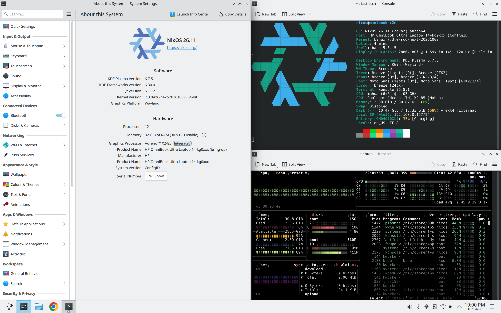

# HP OmniBook Ultra 14-kg0xxx NixOS

**NOT STABLE**, **WIP**, dirty file tree and incomplete README.

> **Disclaimer:** This project is provided as-is, with no warranties of any kind. Installing custom kernels, device trees, or early-stage firmware on your machine carries inherent risks. I am not responsible for any bricked devices, lost data, hardware damage, or system instability caused by using these configurations or instructions. Proceed at your own risk.



- [Supported devices](#supported-devices)
- [Status](#status)
- [Patches in use](#patches-in-use)
- [Firmware](#firmware)
- [Build \& install](#build--install)
  - [Requirements](#requirements)
  - [Build from local repository](#build-from-local-repository)
  - [Build from remote repository](#build-from-remote-repository)
  - [Install](#install)
  - [Boot](#boot)
- [AI disclosure](#ai-disclosure)
- [References](#references)


## Supported devices

- HP OmniBook Ultra 14-kg0xxx running 12 cores Snapdragon X2 Elite (Mahua)
- HP OmniBook Ultra 14-kg0xxx running 18 cores Snapdragon X2 Elite (Glymur) - Untested

## Status

| Works | Notes |
| --- | --- |
| Boot from USB stick | Both USB-C plug orientations (`pmic_glink` stack in the initrd) |
| Internal display (eDP) | `msm`, 60/120 Hz, brightness |
| GPU acceleration | freedreno "Adreno X2-85 (Mahua)" via a patched Mesa device table |
| KDE Plasma 6 (Wayland) | Default boot entry "NixOS KDE (msm)" |
| Keyboard, keyboard backlight, touchpad, touchscreen | |
| Speakers, internal microphones | UCM via `GLYMUR-CRD.conf`; capped volume, thinner sound than Windows (no HP DSP processing) |
| Wi-Fi | Board file borrowed from another HP laptop (linux-firmware `103c:8d99`) |
| Bluetooth | |
| Cameras (RGB + IR) | USB UVC |
| Battery level, lid switch | |
| USB-C data | Both orientations |
| External monitor (USB-C DP) | Off in the default DTB; use "NixOS KDE (msm, USB-C DP test)" entry |

| Partial / not working / untested | Notes |
| --- | --- |
| Suspend | |
| Colour banding | Until the refresh rate is changed once after login |
| HDR, VRR | Not supported by the `msm` eDP driver |
| Resolution / refresh choices | Only the panel's native mode at 60 or 120 Hz |
| Power profiles | No `platform_profile` driver on this SoC: placeholders only |
| Wi-Fi calibration | Not this laptop's board data: range/TX power may differ from Windows |
| Wi-Fi in the tty entries | No NetworkManager there; use a KDE entry |
| CPU Clock | Boost is disabled, untested max clock speed |
| 3.5 mm headphones jack | Untested |
| External monitor (USB-C DP) audio playback | Untested |
| NPU | Untested |

## Patches in use

Applied by `buildLinux` on top of `linux-next` tag `next-20261009`
(`7.3.0-rc6`), in this order (`kernelPatches` in `configuration.nix`):

| # | File | What | Source |
| --- | --- | --- | --- |
| 1 | `patches/mahua-gpu-v1-dt.patch` | Patches 2/5 (Glymur GMU compatible) and 5/5 (`mahua.dtsi` GPU/GMU nodes) of the Mahua GPU series; 1/5, 3/5 (driver) and the bindings are in `next-20261009` | <https://lore.kernel.org/all/20260925-mahua-gpu-v1-0-0fa0bfd8d315@oss.qualcomm.com/> |
| 2 | `patches/glymur-mahua-hp-omnibook-ultra-kg0xxx.patch` | HP OmniBook Ultra 14-kg0xxx board: Qualcomm's Glymur DTS, bindings, SCM allowlist, plus the Mahua DTS derived from it | <https://lore.kernel.org/all/20260830-x2-hp-omnibook-ship-v1-0-9feada71dc79@oss.qualcomm.com/> (Mahua DTS: local); regenerated against `next-20261009` |
| 3 | `patches/glymur-mahua-hp-omnibook-ultra-kg0xxx_2.patch` | Local fixes: `pcie3b_phy` (NVMe), Makefile order, `qcom,mahua` binding, SCMI `arm,no-completion-irq`, USB `role-switch-default-mode = "host"`, `-bringup` DTB (firmware eUSB2 repeaters, USB-C DP off) | Local. SCMI item follows <https://github.com/FixItFoundry/zenbook-a16-linux/blob/HEAD/patches/0001-arm64-dts-qcom-glymur-enable-SCMI-polling-mode.patch> |
| 4 | `patches/glymur-dp-phy-pll-v5.patch` | QMP combo PHY: Glymur DP PLL programming (USB-C DisplayPort), 11 patches | <https://lore.kernel.org/all/20261001-glymur-phy-v3-v5-0-3848c2615d5a@oss.qualcomm.com/> |
| 5 | `patches/dispcc-glymur-no-init-park.patch` | Don't park `disp_cc_mdss_mdp_clk_src` at probe (keeps the firmware framebuffer alive) | Local, same change as upstream `dispcc-x1e80100` |
| 6 | `patches/phy-qcom-edp-v8.patch` | eDP panel PHY v8 power-on sequence (2 patches, Bjorn Andersson) | <https://lore.kernel.org/all/20260622-glymur-edp-phy-v1-0-814b45089ac9@oss.qualcomm.com/> |
| 7 | `patches/qmp-combo-typec-callbacks-v3.patch` | qmp-combo: hold a runtime PM reference in, and check `qmp_combo_com_init()` from, the Type-C switch/mux callbacks (2 patches) | <https://lore.kernel.org/all/20260916133814.3977-1-okerixx@gmail.com/> |
| 8 | `patches/pmic-glink-altmode-ack-undescribed-ports.patch` | pmic_glink_altmode: acknowledge notifications on ports without a connector node (found on the Mahua OmniBook 5) | <https://lore.kernel.org/all/20260930111657.1147-1-theflyingrahul@gmail.com/> |
| 9 | `patches/soundwire-qcom-irq-before-clock-gate-v2.patch` | soundwire: qcom: disable the interrupt before gating the clock (bus clash / parity errors / one speaker side detached after clock stop on x1e80100 and Glymur) | patchwork series 1182199 (linux-arm-msm, 2026-10-09) |
| 10 | `patches/a8xx-gmem-active-slices-v2.patch` | drm/msm/a8xx: report the GMEM size of the active slices (parts with fused-off slices) | patchwork series 1177173 (msm-next v2, 2026-09-30) |
| 11 | `patches/mahua-bringup-usbc-dp.patch` | `mahua-hp-omnibook-ultra-kg0xxx-bringup-dp.dtb`: the bring-up DTB with `mdss_dp0-2` (USB-C DisplayPort) re-enabled, for the "NixOS KDE (msm, USB-C DP test)" entry | Local |

## Firmware

Everything not listed here comes from nixpkgs' `linux-firmware`
(`hardware.enableRedistributableFirmware`): GPU (`qcom/gen80100_*`), Wi-Fi
(`ath12k/WCN7850/hw2.0/amss.bin`, `m3.bin`, `board-2.bin` which also holds
the regdb), Bluetooth (`qca/hmtbtfw20.tlv`, `qca/hmtnv20.b112`), audio
topology. Files in `firmware/` (laid out like `/lib/firmware`) are added
to `hardware.firmware`; the four DSP files are also copied into the initrd
under `/fw` (`firmware_class.path=/fw`) because `qcom_q6v5_pas` boots the
ADSP there for USB-C orientation.

| `firmware/...` | Source | Used for |
| --- | --- | --- |
| `qcom/glymur/hp/omnibook-ultra-14-kg0xxx/qcadsp8480.mbn`, `adsp_dtbs.elf` | Windows driver store, `qcsubsys_ext_adsp8480.inf_arm64_f8056c8c0730b734` (HP, `SUBSYS_8F03103C`) | ADSP: audio, battery/USB-C (pmic_glink) |
| `qcom/glymur/hp/omnibook-ultra-14-kg0xxx/qccdsp8480.mbn`, `cdsp_dtbs.elf` | Windows driver store, `qcnspmcdm8480.inf_arm64_cde10e01d3a2d2e1` (30.0.228) | CDSP |
| `ath12k/WCN7850/hw2.0/board.bin` | linux-firmware `board-2.bin` entry `subsystem-vendor=103c,subsystem-device=8d99` (another HP laptop, module `bncm865a`), extracted | Wi-Fi board data: no `103c:8e64` entry exists upstream, and HP's own files crash the upstream Wi-Fi firmware |

`wlan-bdf/` (installed as `/etc/omnibook/wlan-bdf/`, for
`omnibook-diag --wifi NAME`):

| File | Origin | Result |
| --- | --- | --- |
| `linux-firmware-103c-8d99.elf` | linux-firmware `board-2.bin`, HP `103c:8d99` | works (in use) |
| `linux-firmware-103c-8d68.elf` | linux-firmware `board-2.bin`, HP `103c:8d68` | works |
| `bdwlan_wcn785x_2p0_ncm825_QC_revB.elf`, `bdwlan_wcn785x_2p0_ncm825.elf`, `bdwlan.elf` | Windows `qcwlanhmt8480.inf_arm64_9aa2a33e68f814e4` (the INF maps `SUBSYS_8E64103C` to `QC_revB`) | `-110` |
| `*.bin` (same three names) | raw LOAD segment of each ELF (offset `0x400`, `0x15400` bytes) | firmware crash (`EE_RDDM`) |

## Build & install

Building the image directly on the HP laptop running WSL is strongly recommended (avoiding cross-compilation).

### Requirements

- Nix
- USB C flash drive

### Build from local repository

```bash
nix -L build
```

### Build from remote repository

```bash
nix -L build git+https://github.com/Klbgr/HP-OmniBook-Ultra-14-kg0xxx-NixOS
```

### Install

Generated RAW image will be located at `result/omnibook-x2e.raw`. Flash it to a flash drive using dd, Rufus, Balena Etcher, or whatever similar tool.

### Boot

- Disable secure boot in BIOS (F10)
- Choose flash drive from boot menu (F9)
- Multiple boot entries are available in systemd-boot
  - NixOS tty
    - Boot to tty without msm graphics driver loaded
  - NixOS tty (msm)
    - Boot to tty with msm graphics driver loaded
  - NixOS KDE (software rendering)
    - Boot to KDE without msm graphics driver loaded (CPU rendering)
  - **NixOS KDE (msm)**
    - Boot to KDE with msm graphics driver loaded (GPU rendering)
  - **NixOS KDE (msm, USB-C DP test)**
    - Boot to KDE with msm graphics driver loaded (GPU rendering) and external monitor support

`nixos` user password is `nixos`.

## AI disclosure

Developed with heavy AI assistance (Claude Opus 5); however, all technical decisions, choices, and tests were independently executed and verified.

## References

- Board DTS series (Glymur variant, by Qualcomm):
  <https://lore.kernel.org/all/20260830-x2-hp-omnibook-ship-v1-0-9feada71dc79@oss.qualcomm.com/>
- Mahua GPU/GMU:
  <https://lore.kernel.org/linux-arm-msm/20260925-mahua-gpu-v1-0-0fa0bfd8d315@oss.qualcomm.com/>
- Reference Mahua *board* DTS from Qualcomm (ThinkPad T14s Gen 7), used here as
  the model for what a Mahua board file has to look like:
  <https://lore.kernel.org/all/20260928145122.1337186-1-srinivas.kandagatla@oss.qualcomm.com/>
- Community Mahua bring-up on a sibling HP machine:
  <https://github.com/theflyingrahul/linux-hp-omnibook-5-glymur>